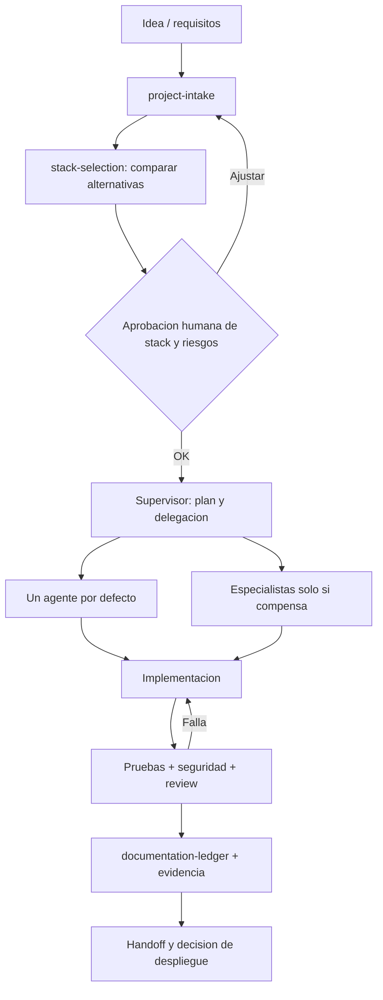

# Arquitectura objetivo

## Componentes
- `AGENTS.md`: política duradera mínima y rutas de skills.
- `agents/`: responsabilidades conceptuales; `.claude/agents/`: adaptadores nativos Claude Code.
- `skills/`: fuente canónica de procedimientos portables (Agent Skills); `.claude/skills/` y `.agents/skills/` son copias generadas por `hub.py sync`.
- `stacks/catalog.json`: alternativas y factores de idoneidad; **no** es un mandato tecnológico.
- `templates/project/`: evidencia de evaluación, decisiones, implementación y control.
- `scripts/hub.py`: utilidades deterministas sin modelos LLM.
- `.github/workflows/quality.yml`: puertas técnicas reproducibles; el owner aún debe habilitar protecciones de rama.

## Coordinacion y alcance real
1. Proyecto inicia con un solo agente y documentos breves.
2. Si hay tareas separables, el supervisor asigna dueño de archivos, entrada, salida, dependencias y presupuesto por trabajo.
3. El traspaso entre agentes se hace mediante contratos versionados, ruta del artefacto, decisiones y resumen compacto.
4. Nunca editar simultáneamente el mismo archivo entre agentes sin coordinación y revisión de merge.
5. Documentación y evidencias persistentes en el repositorio del **proyecto**, no en conversaciones privadas.
6. La biblioteca **no** ejecuta por sí misma agentes remotos ni implementa bus de mensajes: Claude Code / Codex son runtimes externos. Agent Teams de Claude es experimental y opt-in.

## Controles
- Requisitos y stack aprobados antes de cambios amplios.
- Calidad + seguridad + documentación antes de handoff.
- Secretos y acceso a producción requieren controles externos, no solo prompts.
- Optimizar costo por tarea correcta, no por mensaje más corto.

## Decisiones arquitectónicas
Ver `docs/decisions/`. Los cambios de arquitectura deben generar una ADR (Contexto, opciones, decisión, consecuencias y evidencia).